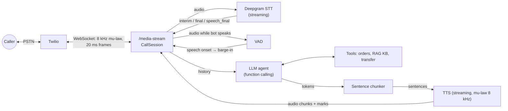

# Realtime Voice Agent

A low-latency AI phone agent for customer support. You call a phone number, talk naturally, and an LLM-powered agent answers by voice. It looks up orders, answers policy questions from a knowledge base, and stops talking the moment you interrupt it.

**Stack:** Python · FastAPI · WebSockets · Twilio Media Streams · Deepgram streaming STT · any OpenAI-compatible LLM (OpenAI / Groq) with function calling · Deepgram Aura or ElevenLabs streaming TTS · BM25 + embedding hybrid RAG · Docker

## What it does

- **Real phone calls** over Twilio: inbound (`/voice` webhook), or outbound, where the bot calls your number (`POST /call`).
- **Fully streamed pipeline**: STT runs while you speak; LLM tokens are cut into sentences and sent to TTS as they arrive; audio goes back to the caller chunk by chunk. Sentence 2 is generated while sentence 1 plays.
- **Barge-in**: talk over the bot and it stops within ~250 ms. Triggered by local VAD (fast) or by interim STT words (robust). The agent's memory keeps only the sentences the caller actually heard, confirmed with Twilio playback marks.
- **Early-endpointing recovery**: if you pause mid-sentence and the bot starts thinking, your next words are merged into the same turn instead of producing two answers.
- **Function calling**: `get_order_status`, `search_knowledge_base`, `transfer_to_human`, with a spoken filler ("One moment...") while tools run.
- **RAG**: BM25 out of the box, optional hybrid with embeddings fused by Reciprocal Rank Fusion.
- **PII redaction**: Aadhaar, PAN, card (Luhn-checked), phone and email, written as digits or spoken as words, are redacted before text reaches the LLM, the logs or the stored transcript.
- **Latency instrumentation**: per-turn, per-stage timings to `logs/latency.jsonl`, with a p50/p95 report.
- **Security**: Twilio webhook signatures checked on `/voice`; `/media-stream` only accepts the secret token from our own TwiML; `/call` and the browser phone need `DEMO_API_TOKEN`.
- **Resilient**: Deepgram reconnects if it drops, LLM and tool calls have timeouts, and transfers dial a real human when `HUMAN_AGENT_NUMBER` is set.
- **Tested offline**: 60 tests, including an end-to-end call over real WebSockets with a Twilio simulator.

## Architecture



One call is one `CallSession` (`app/session.py`), which owns all turn-taking state. Everything is asyncio. A call is a handful of coroutines, and blocking work is network I/O.

## Latency

Fill this in from your own calls: `python scripts/latency_report.py`

| Stage | p50 (ms) | p95 (ms) |
|---|---|---|
| LLM time to first token | | |
| First token → first full sentence | | |
| TTS time to first audio byte | | |
| End of caller speech → first audio sent (server) | | |
| Caller-side voice-to-voice (simulator, includes endpointing) | | |

## Quick start

### 1. Keys

| Service | What for | Notes |
|---|---|---|
| [Deepgram](https://console.deepgram.com) | STT + TTS | One key covers both; free credit on signup |
| [Groq](https://console.groq.com) or [OpenAI](https://platform.openai.com) | LLM | Groq has a free tier and very fast first-token times |
| [Twilio](https://www.twilio.com/try-twilio) | Phone calls | Trial account is enough |
| [ngrok](https://ngrok.com) | Public URL for Twilio to reach your laptop | Free |
| ElevenLabs (optional) | Multilingual TTS incl. Hindi | |

```bash
cp .env.example .env    # then fill in the keys
```

### 2. Install and run the tests

```bash
python -m venv .venv && source .venv/bin/activate   # Windows: .venv\Scripts\activate
pip install -r requirements-dev.txt
pytest -q
```

### 3. Talk to the agent in text (only needs the LLM key)

```bash
python scripts/chat_cli.py
# you> where is my order KE1002
# you> can I return opened earbuds?
```

### 4. Talk to it in your browser (no phone needed)

```bash
uvicorn app.main:app --port 8000
```

Open http://localhost:8000, paste your `DEMO_API_TOKEN`, press **Start call**, and speak (use headphones) or type. The page speaks the Twilio Media Streams protocol, so it exercises the same `CallSession` as a real call.

### 4b. Simulate a phone call from the command line

```bash
uvicorn app.main:app --port 8000
# in another terminal:
python scripts/make_test_audio.py "Hi, where is my order K E one zero zero two?" samples/q1.wav
python scripts/make_test_audio.py "Can I return earbuds if I opened them?" samples/q2.wav
python scripts/make_test_audio.py "Wait, wait, actually stop." samples/stop.wav
# set MEDIA_STREAM_TOKEN in .env first, so the simulator and server share the stream token
python scripts/simulate_call.py --wav samples/q1.wav --wav samples/q2.wav --interrupt-wav samples/stop.wav
```

The simulator prints caller-side voice-to-voice latency per turn and saves everything the bot said to `bot_reply.wav`.

### 5. Real phone call

```bash
ngrok http 8000              # copy the host, e.g. abcd-1234.ngrok-free.app, into PUBLIC_HOST in .env
uvicorn app.main:app --port 8000
```

- **Inbound:** in the Twilio console, set your number's "A call comes in" webhook to `https://<PUBLIC_HOST>/voice` (HTTP POST), then call it.
- **Outbound (cheaper from India):** have the bot call your verified mobile instead of you dialling a US number:

  ```bash
  curl -X POST https://<PUBLIC_HOST>/call -H "X-Demo-Token: <DEMO_API_TOKEN>" \
       -H "Content-Type: application/json" -d '{"to": "+91XXXXXXXXXX"}'
  ```

  On a trial account, enable India under Voice → Settings → Geo permissions, and verify your number first. Trial calls play a short Twilio notice before connecting.

## Configuration highlights

| Variable | Default | Effect |
|---|---|---|
| `ENDPOINTING_MS` | 300 | Silence before STT declares end of turn. Lower = snappier but cuts off slow speakers |
| `BARGE_IN_MIN_SPEECH_MS` | 250 | Continuous speech needed to interrupt the bot via VAD |
| `BARGE_IN_MIN_WORDS` | 2 | Interim STT words needed to interrupt |
| `VAD_PROVIDER` | energy | `silero` for a neural VAD (`pip install silero-vad`; not covered by the test suite) |
| `STT_MODEL` / `STT_LANGUAGE` | nova-2 / en-IN | `hi` for Hindi; try `nova-3` + `multi` for Hinglish |
| `TTS_PROVIDER` | deepgram | `elevenlabs` with `eleven_flash_v2_5` for Hindi |
| `REDACT_BEFORE_LLM` | true | Redact PII before it leaves your server |
| `EMBEDDINGS_ENABLED` | false | Hybrid BM25 + embedding retrieval (needs an embeddings-capable API) |

## Project layout

```
app/
  main.py       FastAPI app: /voice TwiML, /call outbound, /media-stream WebSocket
  stream.py     Shared WebSocket loop: token check, then events into a CallSession
  telephony.py  Twilio signature check, TwiML, outbound call and live transfer
  web.py        Browser test phone (GET /, WS /browser-stream) + static/index.html
  session.py    CallSession: turn-taking, streaming pipeline, barge-in, marks
  stt.py        Deepgram live WebSocket client
  tts.py        Deepgram Aura / ElevenLabs streaming TTS (mu-law 8 kHz out)
  agent.py      Streaming LLM loop with function calling + system prompt
  tools.py      Tool registry, order lookup, KB search, transfer
  rag.py        Markdown chunking, BM25, embeddings, RRF fusion
  text.py       Sentence chunker for TTS
  vad.py        Energy / Silero VAD + speech-onset detector
  audio.py      mu-law codec, resampling, loudness
  pii.py        Aadhaar / PAN / card / phone / email redaction
  latency.py    Per-turn stage timers -> logs/latency.jsonl
data/           Knowledge base (markdown) and sample orders
scripts/        Call simulator, text chat, test-audio generator, latency report
tests/          Unit, orchestration and end-to-end tests (offline fakes)
```

## What I'd do next for production

- Put `/call` behind real auth (accounts, rate limits, an allow-list of numbers) instead of one shared demo token.
- Run several instances behind a load balancer. Each call's WebSocket stays on one instance; keep durable state (transcripts, summaries) in Postgres/Redis.
- Post-call work (summary, sentiment, QA scoring) on a Celery queue, off the real-time path.
- Semantic turn detection (predict "is the caller done?" from the words, not just silence) and backchannel handling ("hmm", "okay" shouldn't interrupt).
- Echo cancellation for speakerphone callers, so the bot doesn't hear itself.
- OpenTelemetry traces per turn; alerts on p95 voice-to-voice latency.
- An eval set of recorded calls: WER per accent/language, tool-call accuracy, groundedness of answers.
- Real warm transfer to a contact-centre queue with the conversation summary attached.
# ai_speach
