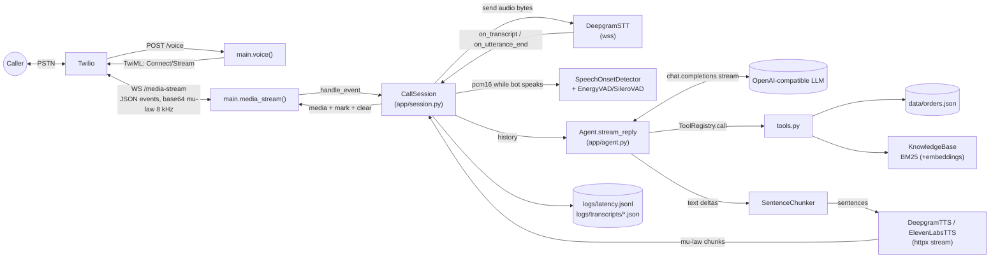

# 02 · Architecture

## Style in one sentence

A **single-process, asyncio, streaming pipeline** ("cascaded" STT → LLM → TTS) where **one `CallSession` object per phone call** owns all turn-taking state, and every external service sits behind a small **Protocol interface** chosen at startup (a light form of **dependency injection**).

## Diagram

See [diagrams/system-architecture.mmd](diagrams/system-architecture.mmd).

## Components and their contracts

| Layer | Protocol (interface) | Real implementation | Test fake |
|---|---|---|---|
| Transport to Twilio | `session.Transport.send_json(dict)` | `main.WebSocketTransport` (adds an `asyncio.Lock`) | `tests.fakes.FakeTransport` |
| Speech-to-text | `stt.STT.start/send/close` + callbacks `TranscriptHandler` | `stt.DeepgramSTT` | `FakeSTT`, `EnergySTT` |
| Reply generator | `session.ReplyAgent.stream_reply(history)` | `agent.Agent` | `ScriptedAgent` |
| Text-to-speech | `tts.TTS.synthesize(text) -> AsyncIterator[bytes]`, `aclose()` | `DeepgramTTS`, `ElevenLabsTTS` | `FakeTTS` |
| VAD | `vad.VAD.is_speech(pcm16)`, `reset()` | `EnergyVAD`, `SileroVAD` | (real `EnergyVAD` used in tests) |

`SessionDeps` (`app/session.py:57-65`) is the bag that holds these. Note `stt_factory` and `vad_factory` are **factories** (one new instance per call, because they hold per-call state/sockets), while `agent` and `tts` are **shared singletons** across calls (stateless per call; TTS reuses one `httpx.AsyncClient` for keep-alive).

## Key design decisions (and why)

| Decision | Evidence | Why | Trade-off |
|---|---|---|---|
| Cascaded STT→LLM→TTS, not speech-to-speech | whole design; `docs/INTERVIEW_NOTES.md` | Text at every step → redact PII, RAG, log, pick best vendor per language | More latency hops |
| Stream at **sentence** granularity | `text.py`, `session._produce/_consume` | TTS needs context for intonation; full reply is too slow | First-chunk latency depends on sentence length → first chunk may cut at a comma (`_find_clause_cut`) |
| Producer/consumer with `asyncio.Queue` inside a `TaskGroup` | `session.py:232-269` | Sentence 2 is generated while sentence 1 is synthesized/sent | Cancellation semantics are subtle |
| No transcoding: mu-law 8 kHz end to end | `stt.py:66`, `tts.py:36,73` | Zero CPU + latency | Locked to telephony audio quality |
| **Twilio marks** to know what was *heard* | `session._on_mark`, `_play_sentence`, `_finalize_turn` | History matches the caller's reality after barge-in | Depends on Twilio echoing marks reliably |
| Two barge-in triggers: VAD + interim words | `session._on_media`, `on_transcript` | VAD fast, STT robust to noise | Echo / backchannels ("hmm") can false-trigger |
| Tool-call **filler** phrase | `agent.py:94-96` | Avoid dead air during an extra LLM round trip | Says "One moment…" even for fast tools |
| PII redaction before LLM | `session._end_user_turn` → `pii.redact` | LLM is third party | Regex misses numbers spoken as words |
| Protocols + factories (DI) | `session.py:49-65`, `main.build_deps` | Offline tests with fakes | Slight indirection |
| In-memory per-call state | `CallSession.__init__` | Simple, fast | Can't move a call between instances; no recovery after crash |
| BM25 implemented in-house + optional embeddings, fused by RRF | `rag.py` | Runs with no API key; RRF needs no score normalization | Re-tokenizes every query; fine for ~20 chunks |

## Patterns present / absent

- ✅ Dependency injection (manual, via `SessionDeps` + `create_app(deps)`)
- ✅ Strategy pattern (TTS provider, VAD provider)
- ✅ Registry pattern (`ToolRegistry`)
- ✅ Producer/consumer (`_produce` / `_consume`)
- ✅ State machine (implicit: `bot_speaking`, `turn_finalized`, `turn_no`, `response_task`)
- ❌ MVC / layered "controller-service-repository" — not applicable, no DB
- ❌ ORM / repositories / migrations — none
- ❌ Queues / caches / microservices — none (listed as future work in README)
- ⚠️ Authentication — only a shared demo token on `/call`. See [11-known-issues-and-risks.md](11-known-issues-and-risks.md).

## Concurrency model (important!)

Everything runs on **one event loop**. Per call there are at least these concurrent coroutines:

1. `main.media_stream` loop — reads Twilio messages, awaits `session.handle_event`.
2. `DeepgramSTT._receive` task — reads Deepgram messages, awaits session callbacks.
3. `DeepgramSTT._keepalive` task.
4. `CallSession.response_task` → inside a `TaskGroup`: `_produce` and `_consume`.

(1) and (2) can **both** call `barge_in()` / mutate session state. They never run *simultaneously* (single thread) but they **interleave at every `await`**. That's why `barge_in()` cancels the task and commits history *before* its first `await` (`session.py:202-209`), and why `WebSocketTransport` has a lock.
